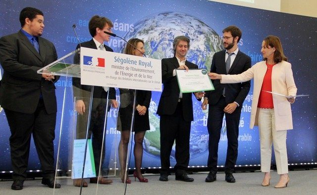

::: {.about-grid}
::: {.prose}
Je suis docteur en physique et data scientist senior, basé à Montpellier. Mon métier : rendre des données complexes fiables, puis les faire parler, avec des modèles statistiques, des cartes et des applications que d'autres peuvent reprendre.

Après dix ans de physique des matériaux et de R&D, j'ai choisi la data science. Les outils de modélisation me permettaient enfin d'étudier des comportements humains avec la même rigueur que des phénomènes physiques. J'ai travaillé pour le CNRS sur le climat urbain, pour des gestionnaires d'espaces naturels et pour des collectivités, puis près de cinq ans comme biostatisticien au service de néphrologie du CHU de Montpellier.

Ce qui me guide : comprendre le terrain, développer des outils robustes et documentés, et faciliter la compréhension pour que les décisions soient mieux éclairées. J'aime transmettre, et j'ai formé des clients, des collègues et des étudiants dans l'industrie, à l'université, dans les collectivités et à l'hôpital.
:::

::: {.photo}
{.lightbox}
:::
:::

::: {.block}
::: {.sec-head}
[L'atout transverse]{.eyebrow}

## Quatre domaines, une seule méthode

[Changer de domaine m'a appris à entrer vite dans le vocabulaire des experts. Les méthodes restent les mêmes, et c'est leur transfert d'un domaine à l'autre qui apporte des idées neuves.]{.lead}
:::

::: {.bridge}
::: {.bridge-item}
[2001–2012]{.years}

**Physique**

Couches minces, spectres optiques, modèles inverses
:::
::: {.bridge-item}
[2014–2016]{.years}

**Climat & énergie**

Comportements des ménages, modèle de climat urbain
:::
::: {.bridge-item}
[2016–]{.years}

**Territoires & société**

Enquêtes, perceptions, espaces naturels, données ouvertes
:::
::: {.bridge-item}
[2020–2024]{.years}

**Santé**

Cohortes, survie, mesures répétées, biomarqueurs
:::
:::
:::

::: {.block}
::: {.sec-head}
[Autodidacte, et vérifiable]{.eyebrow}

## Ce qui garantit la rigueur sans diplôme de statistique

[Quatre éléments que vous pouvez vérifier vous-même.]{.lead}
:::

::: {.proofs}
::: {.proof-item}
### Des pairs ont validé les méthodes

23 publications, dont 17 articles à comité de lecture : Kidney International Reports (2023), American Journal of Transplantation (2022), La Météorologie (2019), Geoscientific Model Development (2017)…

[Voir les publications →](publications.qmd)
:::
::: {.proof-item}
### Une formation quantitative de haut niveau

Doctorat de physique (Université Pierre et Marie Curie, 2005, mention très honorable). Puis une formation continue en statistique et data science depuis 2012 : Stanford, Duke, Johns Hopkins, DataCamp, Udemy.
:::
::: {.proof-item}
### Des responsabilités en biostatistique clinique

Biostatisticien senior au CHU de Montpellier (2020–2024) : analyses de survie, mesures répétées, pipelines automatisés, 9 thèses accompagnées.

[Voir une étude clinique →](projects/c5b9.qmd)
:::
::: {.proof-item}
### Du code ouvert et relisible

Packages R documentés, pipelines targets, historique Git : chaque résultat peut être relu et reproduit, ce qui vaut mieux qu'une promesse.

[Voir GitHub →](https://github.com/AcidyBee)
:::
:::
:::

::: {.block}
::: {.sec-head}
[Chronologie]{.eyebrow}

## Expériences et formation
:::

::: {#timeline}
:::
:::
