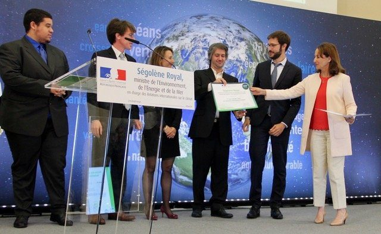

::: {.about-grid}
::: {.prose}
I hold a PhD in physics and work as a senior data scientist in Montpellier, France. My job is to make complex data reliable, then make it speak, using statistical models, maps and apps that others can reuse.

After ten years in materials physics and R&D, I moved into data science. Modelling tools finally let me study human behaviour with the same rigour as physical phenomena. I worked for the CNRS on urban climate, for nature-reserve managers and local authorities, then spent almost five years as a biostatistician in the nephrology department of Montpellier University Hospital.

What drives me: understand the field, build robust and documented tools, and make results easy to grasp so decisions are better informed. I enjoy teaching, and I have trained clients, colleagues and students in industry, universities, local government and hospitals.
:::

::: {.photo}
{.lightbox}
:::
:::

::: {.block}
::: {.sec-head}
[The cross-domain advantage]{.eyebrow}

## Four fields, one method

[Moving between fields taught me to pick up domain experts' vocabulary quickly. The methods stay the same, and carrying them from one field to another is where new ideas come from.]{.lead}
:::

::: {.bridge}
::: {.bridge-item}
[2001–2012]{.years}

**Physics**

Thin films, optical spectra, inverse models
:::
::: {.bridge-item}
[2014–2016]{.years}

**Climate & energy**

Household behaviour, urban climate model
:::
::: {.bridge-item}
[2016–]{.years}

**Territories & society**

Surveys, perceptions, nature reserves, open data
:::
::: {.bridge-item}
[2020–2024]{.years}

**Health**

Cohorts, survival, repeated measures, biomarkers
:::
:::
:::

::: {.block}
::: {.sec-head}
[Self-taught, and verifiable]{.eyebrow}

## What backs the rigour without a statistics degree

[Four things you can check for yourself.]{.lead}
:::

::: {.proofs}
::: {.proof-item}
### Peers have vetted the methods

23 publications, including 17 peer-reviewed articles: Kidney International Reports (2023), American Journal of Transplantation (2022), La Météorologie (2019), Geoscientific Model Development (2017)…

[See publications →](publications.qmd)
:::
::: {.proof-item}
### Advanced quantitative training

PhD in physics (Université Pierre et Marie Curie, 2005, highest honours), followed by continuous training in statistics and data science since 2012: Stanford, Duke, Johns Hopkins, DataCamp, Udemy.
:::
::: {.proof-item}
### Responsibility for clinical biostatistics

Senior biostatistician at Montpellier University Hospital (2020–2024): survival analysis, repeated measures, automated pipelines, 9 theses supported.

[See a clinical study →](projects/c5b9.qmd)
:::
::: {.proof-item}
### Open, reviewable code

Documented R packages, targets pipelines, Git history: every result can be reviewed and reproduced.

[See GitHub →](https://github.com/AcidyBee)
:::
:::
:::

::: {.block}
::: {.sec-head}
[Timeline]{.eyebrow}

## Experience and education
:::

::: {#timeline}
:::
:::
