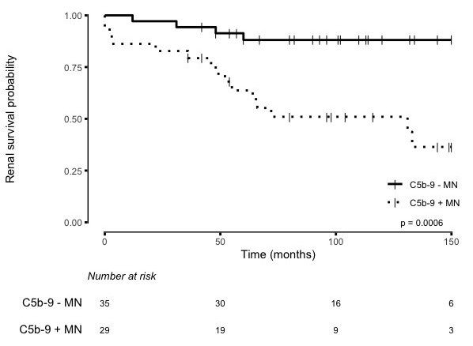
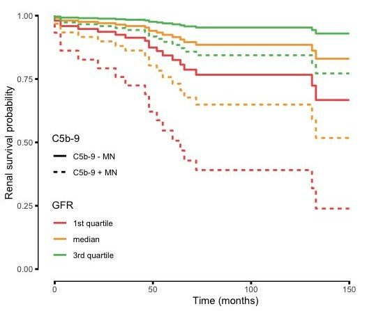
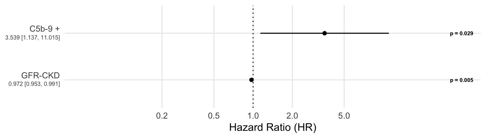
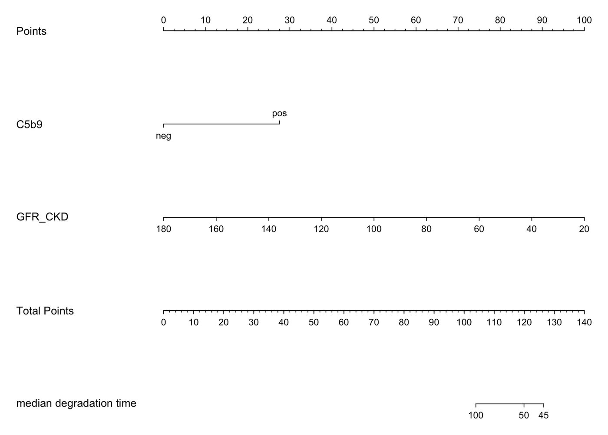
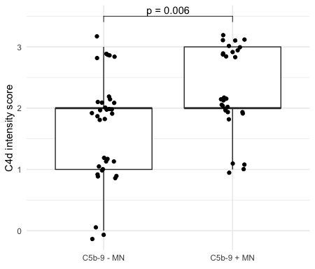

## Context

Membranous nephropathy progresses very differently from one patient to another. Nephrologists were looking for a simple histological marker to spot high-risk cases early.

## Question

Does the presence of glomerular C5b-9 deposits at biopsy predict renal function decline?

## Data

Cohort of 64 biopsied patients (35 C5b-9−, 29 C5b-9+), followed up to 150 months: histology, GFR, clinical follow-up.

## Method

- Kaplan-Meier curves and log-rank test
- Multivariable Cox model (C5b-9, GFR), checking the proportional-hazards assumption
- Predictions by GFR quartile and a nomogram for clinical use

## Results

Renal survival is markedly poorer in C5b-9+ patients. At equal GFR, the hazard of renal decline is about 3.5 times higher (HR 3.54; 95% CI 1.14 to 11.0). The interval is wide, reflecting the sample size (64 patients), and calls for validation in an external cohort. C5b-9 deposits also go together with higher C4d intensity.

## Figures {.figures}

::: {.gallery}
{.lightbox group="c5b9"}

{.lightbox group="c5b9"}

{.lightbox group="c5b9"}

{.lightbox group="c5b9"}

{.lightbox group="c5b9"}
:::

::: {.case-cta}
[A similar project? Let's talk](../contact.qmd){.btn .btn-honey}
:::
