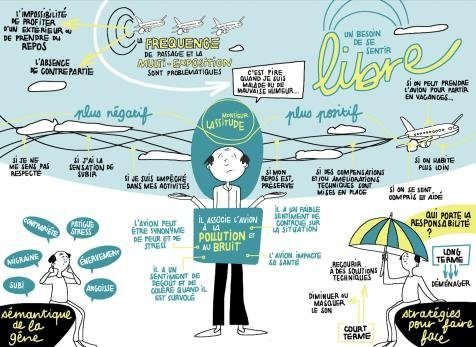
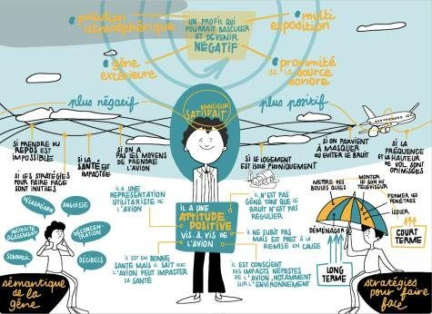

## Context

Annoyance from aircraft noise is not only about decibels. It also depends on each person's experience, expectations and coping strategies.

## Question

Can we identify groups of residents with a similar experience, to tailor communication and action?

## Data

Quantitative questionnaire, N = 1,250 respondents.

## Method

- Proposed method: principal component analysis on the questionnaire's quantitative variables
- Then hierarchical clustering, consolidated where needed with k-nearest neighbours
- One representative individual (persona) per cluster; analysis carried out by the team and reviewed by me

## Results

Six profiles of experience (for example “Mr Weariness”, “Mr Satisfied”), illustrated through graphic facilitation so that every stakeholder can understand them.

## Figures {.figures}

::: {.gallery}
{.lightbox group="cigale"}

{.lightbox group="cigale"}
:::

::: {.case-cta}
[A similar project? Let's talk](../contact.qmd){.btn .btn-honey}
:::
