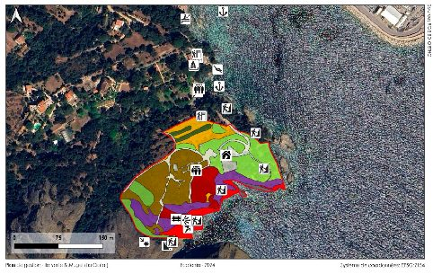
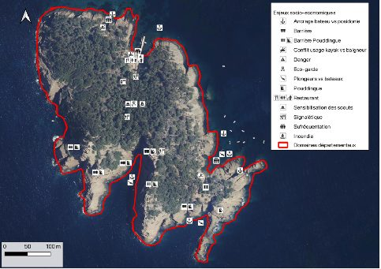
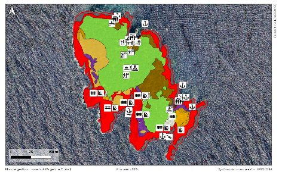
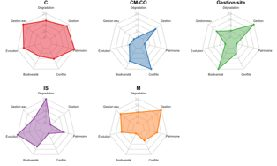
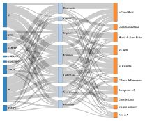
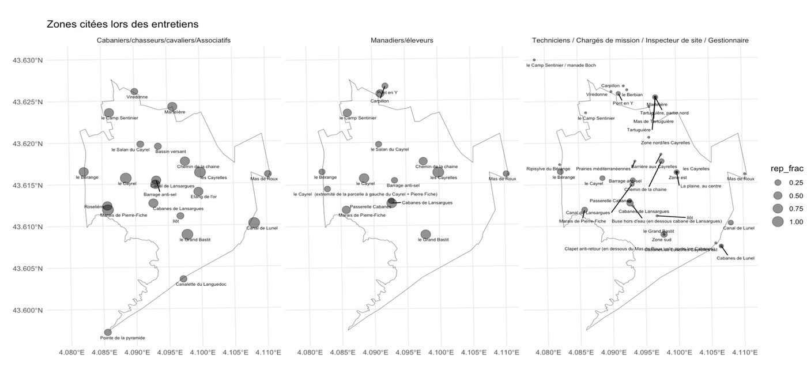
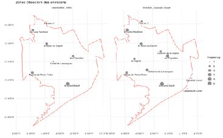
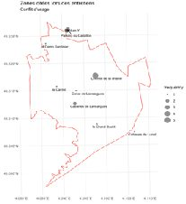

## Context

A management plan must reconcile biodiversity, landscape and use. Stakeholders (managers, users, technicians) read the site differently.

## Question

Which areas and themes stand out for each group of stakeholders, and where do they overlap with ecological stakes?

## Data

Interviews coded by area mentioned and by theme; ecological and land-use layers (Parc du Mugel, Île Verte).

## Method

- Radar charts: importance of themes by stakeholder
- Interactive Sankey diagram: areas mentioned and related themes
- Mapping in R (ggplot2 + sf) and layer overlays in QGIS

## Results

Summary maps locating use conflicts, habitat degradation and landscape change, used as a basis for discussion with stakeholders.

## Figures {.figures}

::: {.gallery}
{.lightbox group="ens"}

{.lightbox group="ens"}

{.lightbox group="ens"}

{.lightbox group="ens"}

{.lightbox group="ens"}

{.lightbox group="ens"}

{.lightbox group="ens"}

{.lightbox group="ens"}
:::

::: {.case-cta}
[A similar project? Let's talk](../contact.qmd){.btn .btn-honey}
:::
