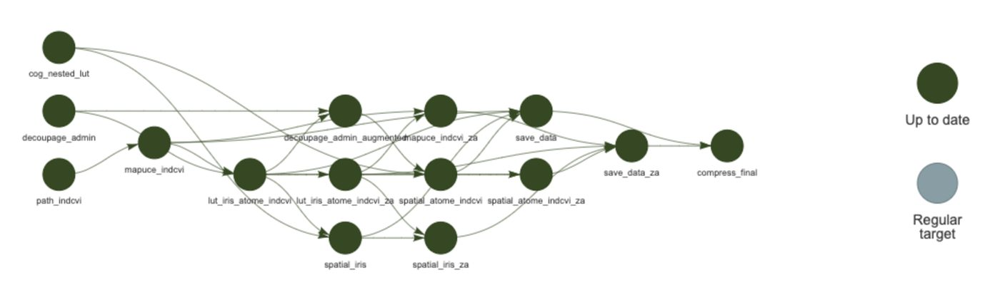
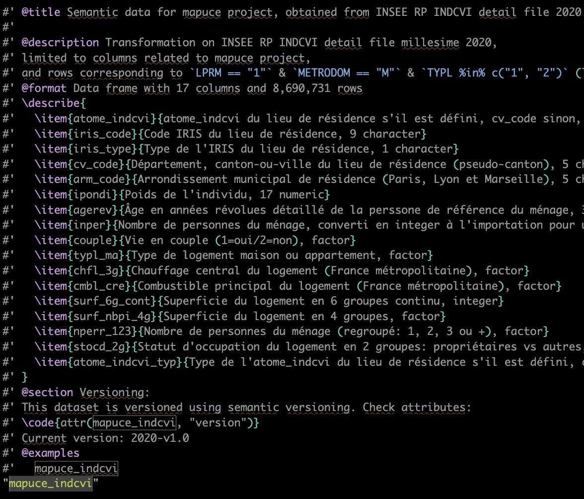
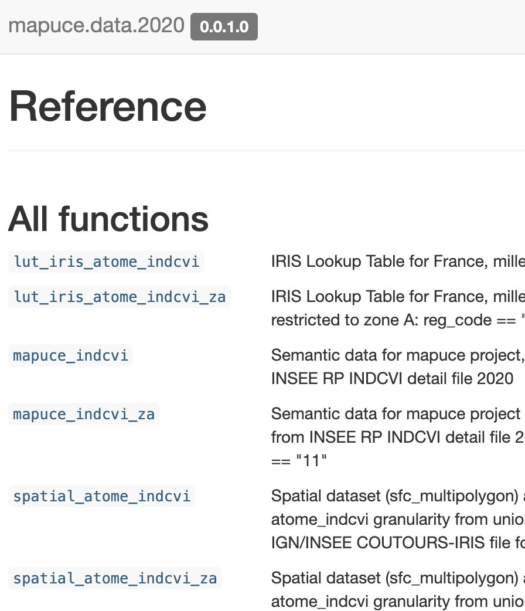
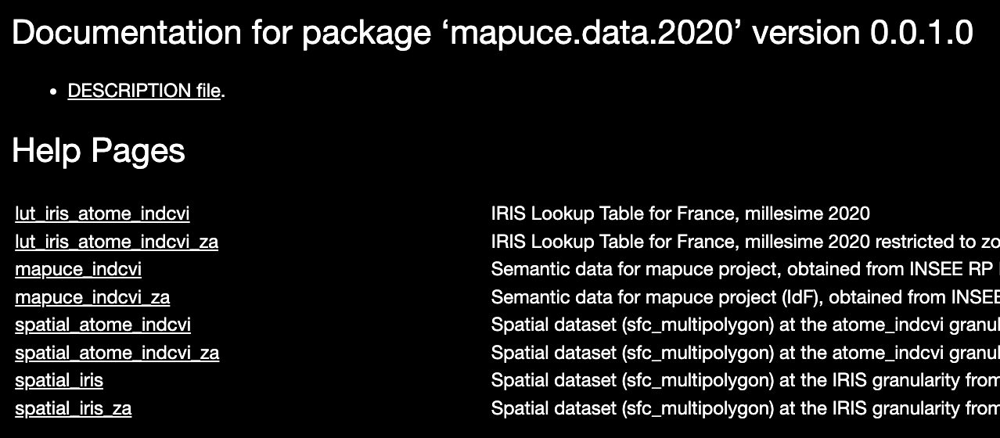
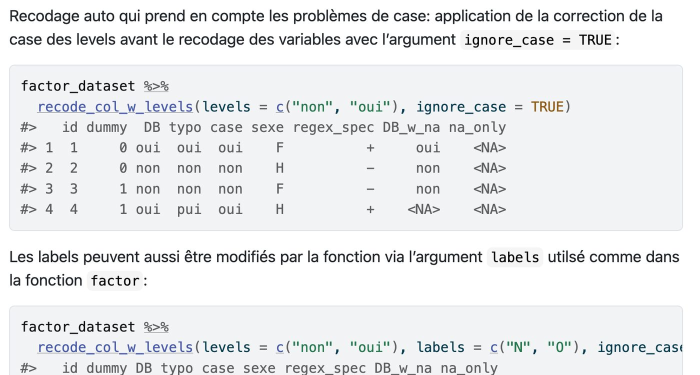
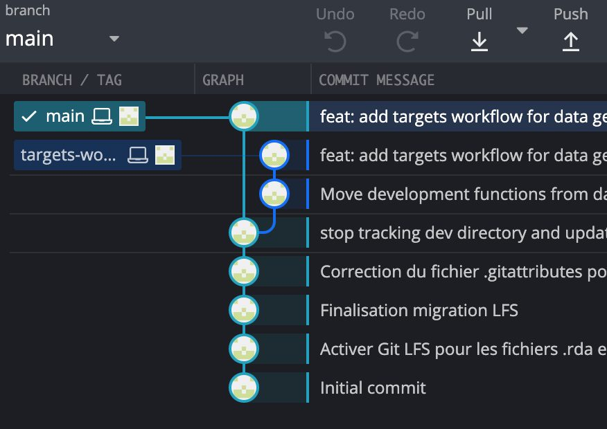
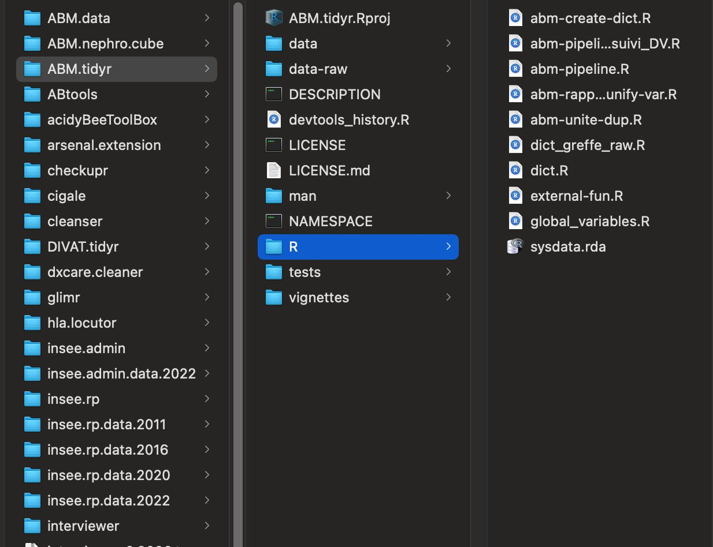
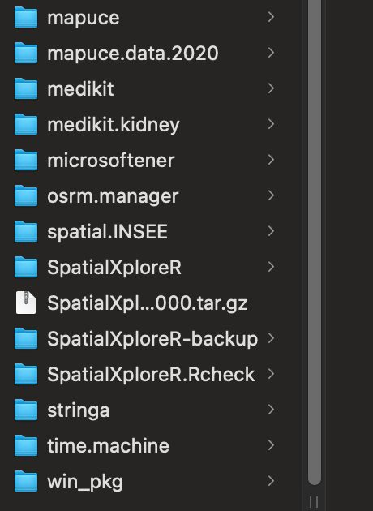

## Context

A result you cannot regenerate is a fragile result. I build every project so that a colleague can pick it up and rerun it.

## Question

How do you make data Findable, Accessible, Interoperable and Reusable in everyday work?

## Data

Example: mapuce.data.2020, built from the INSEE 2020 census detail file (8,690,731 rows, 17 columns), with its spatial layers.

## Method

- Data packages: every variable documented (roxygen2), pkgdown site, semantic versioning
- targets pipeline: only the steps affected by a change are recomputed
- cleanser package: automated, traceable checks and recoding; Git and Git LFS for large files

## Results

About 30 R packages built and maintained, including 5 data packages (health, INSEE, spatial, routing…), reused from one project to the next.

## Figures {.figures}

::: {.gallery}
{.lightbox group="fair"}

{.lightbox group="fair"}

{.lightbox group="fair"}

{.lightbox group="fair"}

{.lightbox group="fair"}

{.lightbox group="fair"}

{.lightbox group="fair"}

{.lightbox group="fair"}
:::

::: {.case-cta}
[A similar project? Let's talk](../contact.qmd){.btn .btn-honey}
:::
