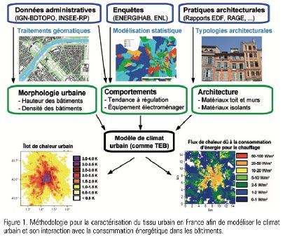
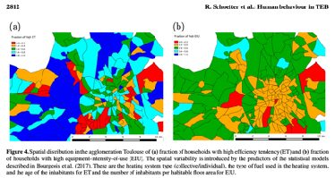
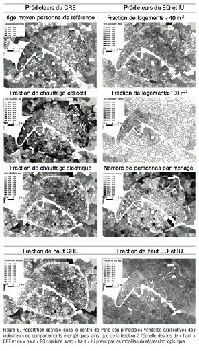

## Context

Urban heat islands also depend on how people live: heating, air conditioning, appliances. Météo-France's TEB urban climate model did not represent this diversity of behaviour.

## Question

Can household energy behaviour be predicted from variables available everywhere in France, so it can be fed into TEB?

## Data

Three surveys with different granularities and groupings (Energihab, INSEE housing data, National Housing Survey), harmonised through extensive feature engineering.

## Method

- Harmonising variables across surveys, selecting informative predictors
- Machine learning models selected by 10-fold cross-validation
- Applying the models at census-tract level and mapping them (Toulouse, Paris)

## Results

Models of thermal regulation, appliance ownership and usage intensity, applicable to all of mainland France at census-tract level and integrated into the TEB parameterisation (SURFEX v8.2). They were then turned into SpatialXploreR, a foresight app.

## Figures {.figures}

::: {.gallery}
{.lightbox group="mapuce"}

{.lightbox group="mapuce"}

{.lightbox group="mapuce"}
:::

::: {.case-cta}
[A similar project? Let's talk](../contact.qmd){.btn .btn-honey}
:::
