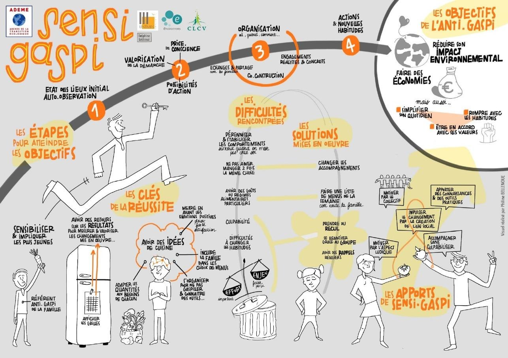
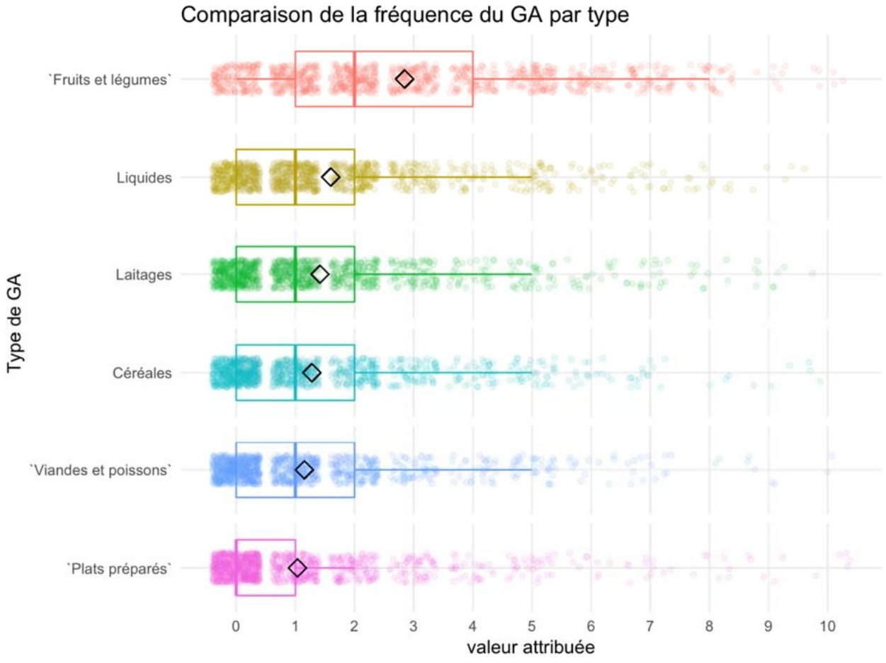
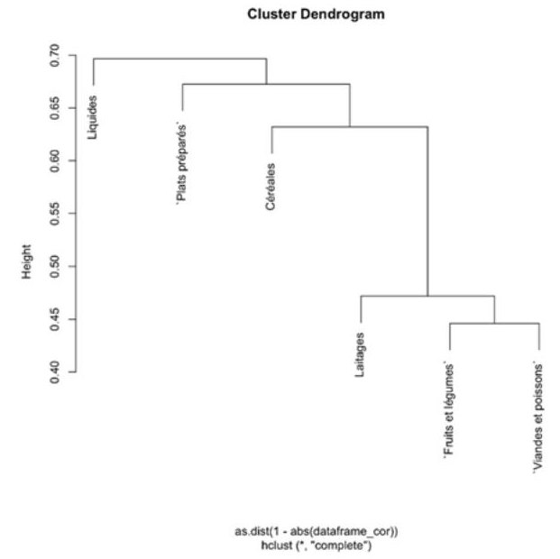
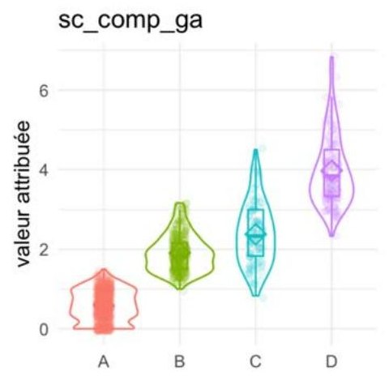
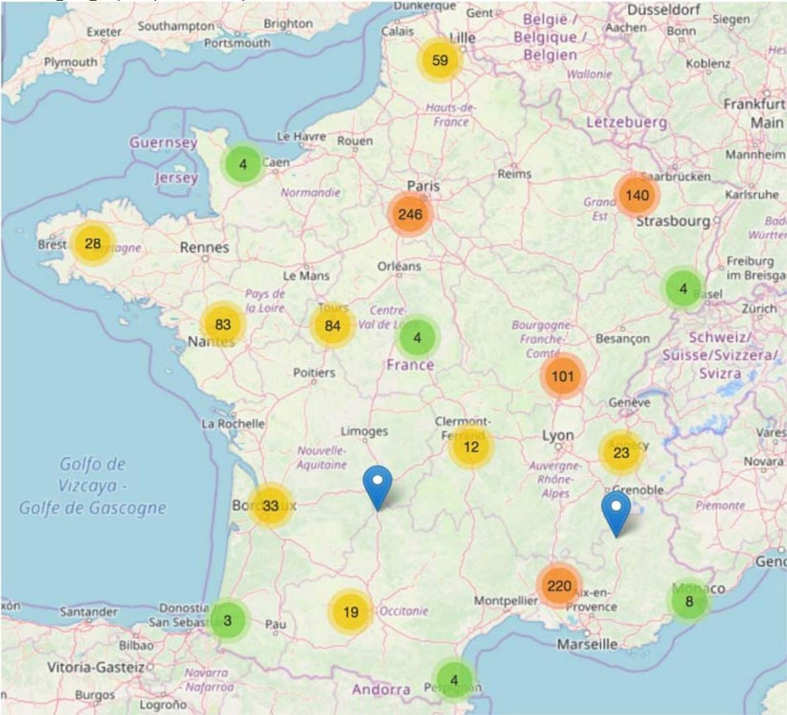

## Context

In France, households are the largest source of food loss and waste (33% of total weight, ADEME 2016). The SENSI-GASPI project (May 2018 – February 2021) set out to help families change their habits, building on social and environmental psychology.

## Question

Which food-waste behaviour profiles can be distinguished, and how do they relate to eating habits, eco-friendly practices and psychological variables (emotions, motivations, perceived control)?

## Data

Online questionnaire, 1,153 respondents: 822 without and 331 with a guilt-relieving message in the introduction. Self-reported waste for six food types (0 to 10 scale), eco-friendly practices, eating habits and about a dozen psychological scales.

## Method

- Cleaning and recoding, detection of outliers and missing values, manual and automatic imputation
- Correlations between food types, hierarchical clustering of variables, PCA: an overall waste score (first dimension, 48% of the information)
- A four-group typology for each family of practices, crossed with every other variable in the questionnaire
- Comparison of the two questionnaire versions (effect of the message) and mapping of where respondents live

## Results

Self-reported waste is low, except for fresh fruit and vegetables (mean 2.9 out of 10, versus 1 to 1.6 for other foods). It is a consistent behaviour: people who waste one type of food also waste the others. The less people waste, the more eco-friendly practices and good eating habits they report. The guilt-relieving message shifts answers on waste (around 15% on the score), a sign of social desirability bias. An acknowledged limitation: a volunteer sample, more educated and more aware than average. These results shaped the follow-up experiment with 21 families over 15 months.

## Figures {.figures}

::: {.gallery}
{.lightbox group="sensigaspi"}

{.lightbox group="sensigaspi"}

{.lightbox group="sensigaspi"}

{.lightbox group="sensigaspi"}

{.lightbox group="sensigaspi"}
:::

::: {.case-cta}
[A similar project? Let's talk](../contact.qmd){.btn .btn-honey}
:::
