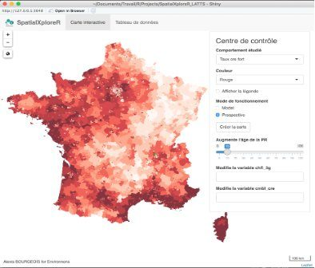
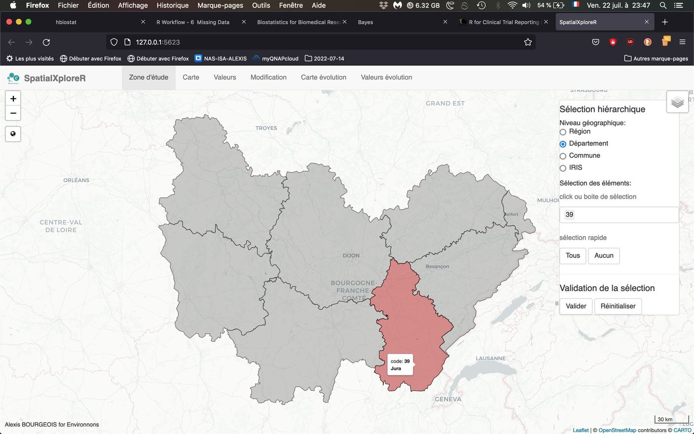
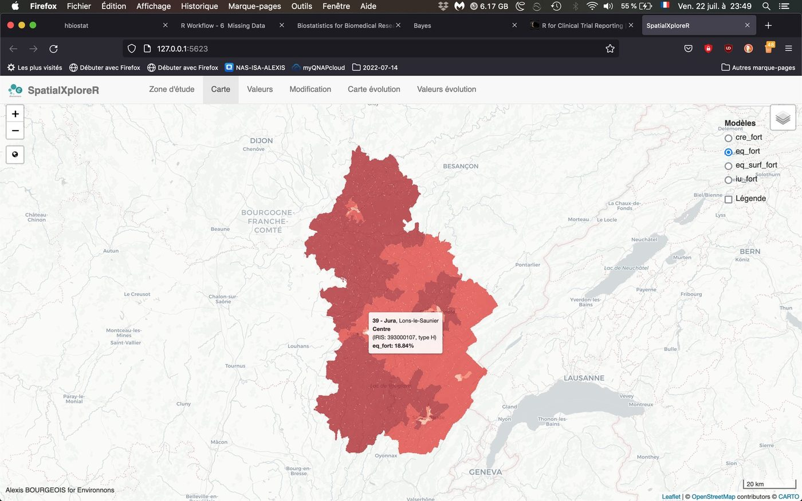
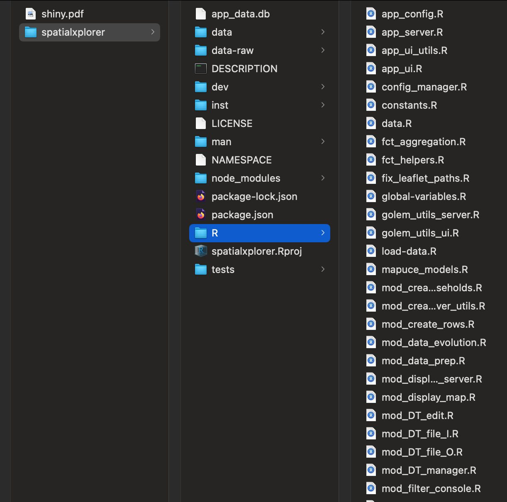

## Context

Once the MApUCE project ended, its household energy-behaviour models had to be useful beyond the papers: exploring territories and simulating how they change. I built the app within Environnons, for the CNRS.

## Question

How can non-specialists use statistical models to simulate future scenarios, at fine scale and without lag?

## Data

More than 50,000 census-tract polygons for mainland France, linked to model outputs.

## Method

- Hierarchical area selection (region, département, municipality, tract) to limit computation and rendering
- Modular app packaged with golem: each tab is a testable module
- Foresight mode: change variables and see the effect on the map

## Results

An app that lets users pick an area, apply the models, aggregate results and simulate changes in a few clicks: for example an ageing population, or a shift in heating system or fuel.

## Figures {.figures}

::: {.gallery}
{.lightbox group="spatialxplorer"}

{.lightbox group="spatialxplorer"}

{.lightbox group="spatialxplorer"}

{.lightbox group="spatialxplorer"}
:::

::: {.case-cta}
[A similar project? Let's talk](../contact.qmd){.btn .btn-honey}
:::
