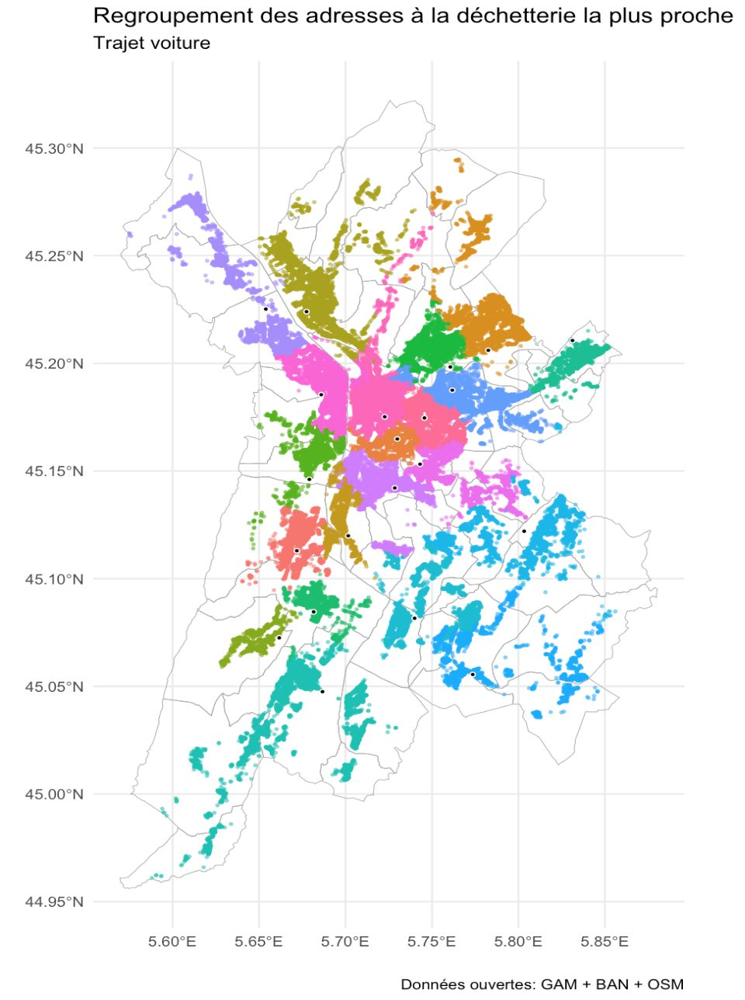
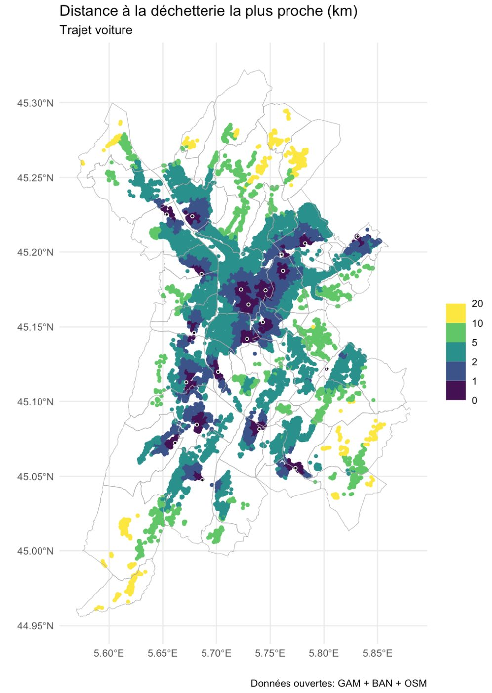
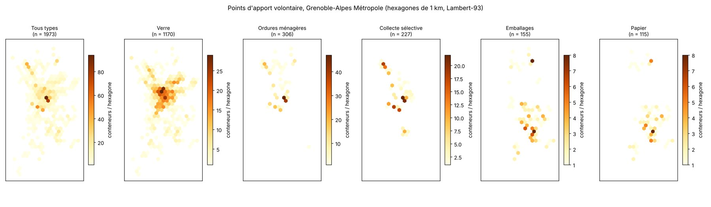
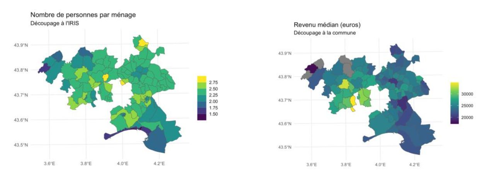
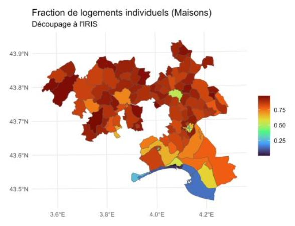

## Context

To win a tender, nothing beats a demonstration on the client's own territory, delivered within days.

## Question

What does open data reveal about the Pic-Saint-Loup and Étang de l'Or area? How far, really, are residents from their nearest recycling centre (Grenoble-Alpes Métropole)?

## Data

INSEE (housing census, FILOSOFI income, tract boundaries), BAN (addresses), OSM (road network), metropolitan open data (recycling centres, 1,973 drop-off containers).

## Method

- Aggregation at tract and municipal level, choropleth maps
- Local OSRM server to compute routes and travel times automatically
- Assigning each address to the nearest recycling centre by road
- Drop-off points: quality checks (inconsistent codes, free-text dates), Lambert-93 projection, 1 km hexbin, in R (targets, sf) and Python (geopandas)

## Results

A strong contrast between primary-residence areas and coastal second-home areas, with intermediate hubs (Mauguio, Lunel, Sommières). A map of actual road distances at address level for the Grenoble metropolitan area. The drop-off hexbin reveals two collection schemes: the Grand-Sud sector (Vizille, Jarrie…) separates packaging and paper, while the rest of the area relies mostly on mixed recycling. A caveat: depending on how the grid is anchored, the maximum per hexagon ranges from 86 to 133 containers (the modifiable areal unit problem). The grid is therefore anchored on whole kilometres, and interpretation focuses on overall patterns rather than any single cell.

## Figures {.figures}

::: {.gallery}
{.lightbox group="territoires"}

{.lightbox group="territoires"}

{.lightbox group="territoires"}

{.lightbox group="territoires"}

{.lightbox group="territoires"}
:::

::: {.case-cta}
[A similar project? Let's talk](../contact.qmd){.btn .btn-honey}
:::
