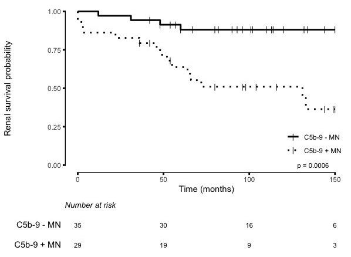
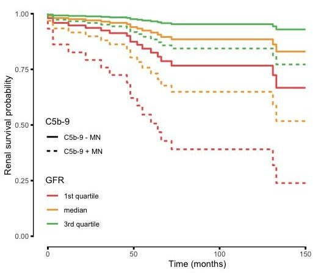
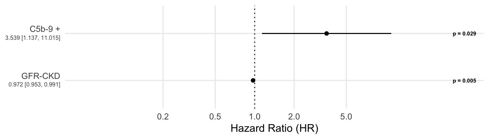
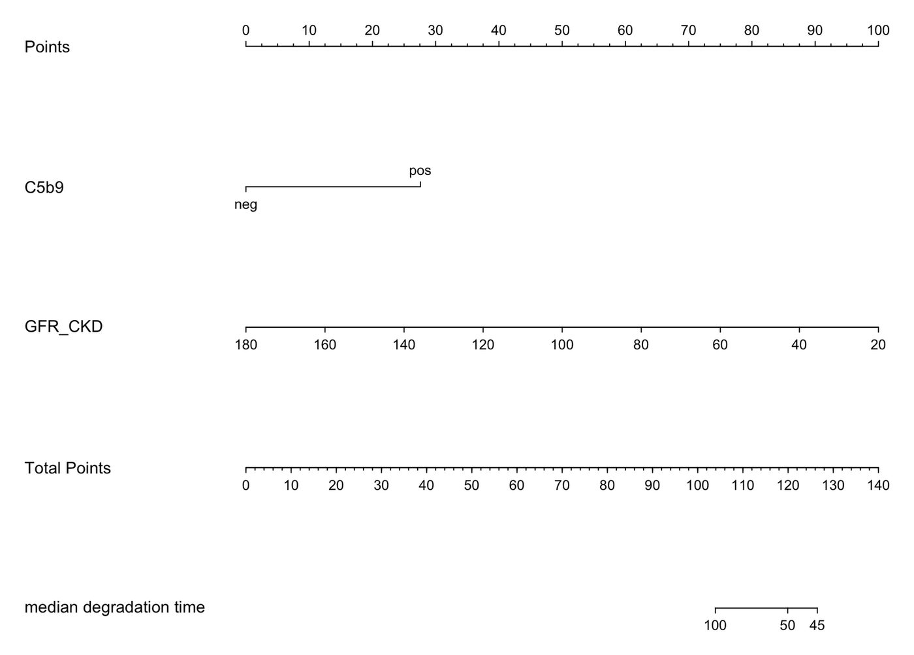
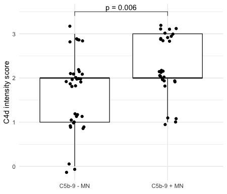

## Contexte

La néphropathie membraneuse évolue très différemment selon les patients. Les néphrologues cherchaient un marqueur histologique simple pour repérer tôt les formes à risque.

## Question

La présence de dépôts glomérulaires de C5b-9 à la biopsie prédit-elle la dégradation de la fonction rénale ?

## Données

Cohorte de 64 patients biopsiés (35 C5b-9−, 29 C5b-9+), suivis jusqu'à 150 mois : histologie, DFG, suivi clinique.

## Méthode

- Courbes de Kaplan-Meier et test du log-rank
- Modèle de Cox multivarié (C5b-9, DFG), vérification de l'hypothèse des risques proportionnels
- Prédictions par quartile de DFG et nomogramme pour la lecture clinique

## Résultats

La survie rénale est nettement plus faible chez les patients C5b-9+. À DFG égal, le risque instantané de dégradation est environ 3,5 fois plus élevé (HR 3,54 ; IC 95 % 1,14 à 11,0). L'intervalle reste large : il reflète l'effectif (64 patients) et appelle une validation sur une cohorte externe. Les dépôts de C5b-9 vont aussi de pair avec une intensité C4d plus élevée.

## Figures {.figures}

::: {.gallery}
{.lightbox group="c5b9"}

{.lightbox group="c5b9"}

{.lightbox group="c5b9"}

{.lightbox group="c5b9"}

{.lightbox group="c5b9"}
:::

::: {.case-cta}
[Un projet similaire ? Parlons-en](../contact.qmd){.btn .btn-honey}
:::
