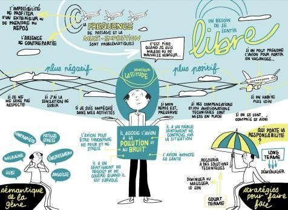
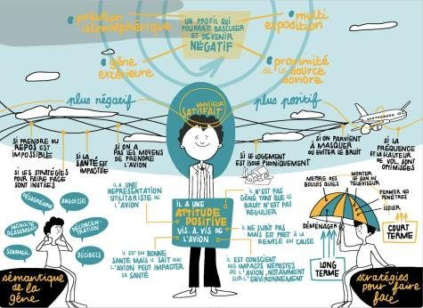

## Contexte

La gêne due au bruit des avions ne dépend pas seulement des décibels : elle dépend aussi du vécu, des attentes et des stratégies de chacun.

## Question

Peut-on identifier des groupes de riverains au ressenti homogène, pour adapter la communication et l'action ?

## Données

Questionnaire quantitatif, N = 1 250 répondants.

## Méthode

- Méthodologie proposée : analyse en composantes principales sur les variables quantitatives du questionnaire
- Puis classification hiérarchique, consolidée si besoin par les k plus proches voisins
- Construction d'un individu représentatif (parangon) par classe ; analyse réalisée par l'équipe, que j'ai revue

## Résultats

Six profils de ressenti (par exemple « Monsieur lassitude », « Monsieur satisfait »), illustrés en facilitation graphique pour être compris par tous les acteurs.

## Figures {.figures}

::: {.gallery}
{.lightbox group="cigale"}

{.lightbox group="cigale"}
:::

::: {.case-cta}
[Un projet similaire ? Parlons-en](../contact.qmd){.btn .btn-honey}
:::
