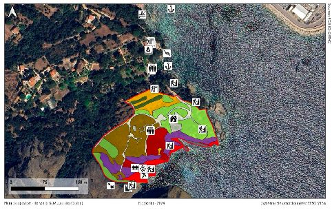
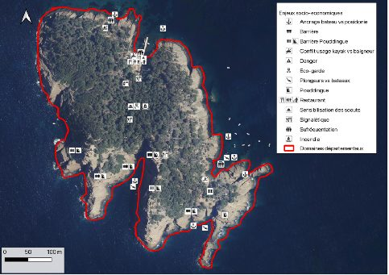
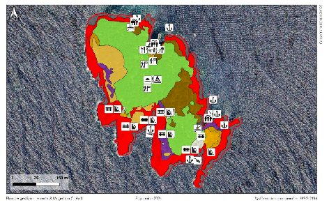
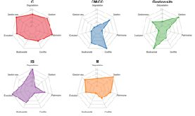
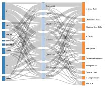
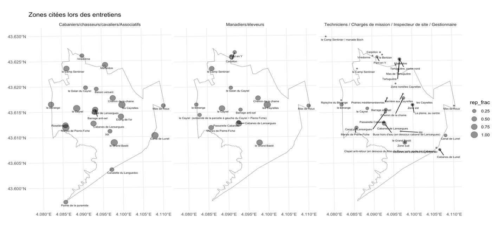
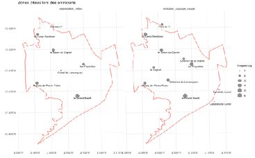
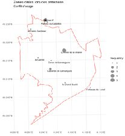

## Contexte

Un plan de gestion doit concilier biodiversité, paysages et usages. Les acteurs (gestionnaires, usagers, techniciens) n'ont pas la même lecture du site.

## Question

Quelles zones et quels thèmes ressortent pour chaque groupe d'acteurs, et où se superposent-ils aux enjeux écologiques ?

## Données

Entretiens codés par zone citée et par thème ; couches écologiques et d'usages (Parc du Mugel, Île Verte).

## Méthode

- Diagrammes radar : importance des thèmes par acteur
- Diagramme de Sankey interactif : zones citées et thèmes associés
- Cartographie R (ggplot2 + sf) et croisement de couches sous QGIS

## Résultats

Des cartes de synthèse qui localisent les conflits d'usage, la dégradation du milieu et l'évolution des paysages, et qui servent de base de discussion avec les acteurs.

## Figures {.figures}

::: {.gallery}
{.lightbox group="ens"}

{.lightbox group="ens"}

{.lightbox group="ens"}

{.lightbox group="ens"}

{.lightbox group="ens"}

{.lightbox group="ens"}

{.lightbox group="ens"}

{.lightbox group="ens"}
:::

::: {.case-cta}
[Un projet similaire ? Parlons-en](../contact.qmd){.btn .btn-honey}
:::
