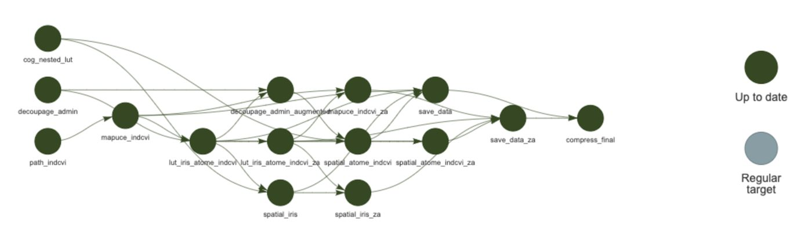
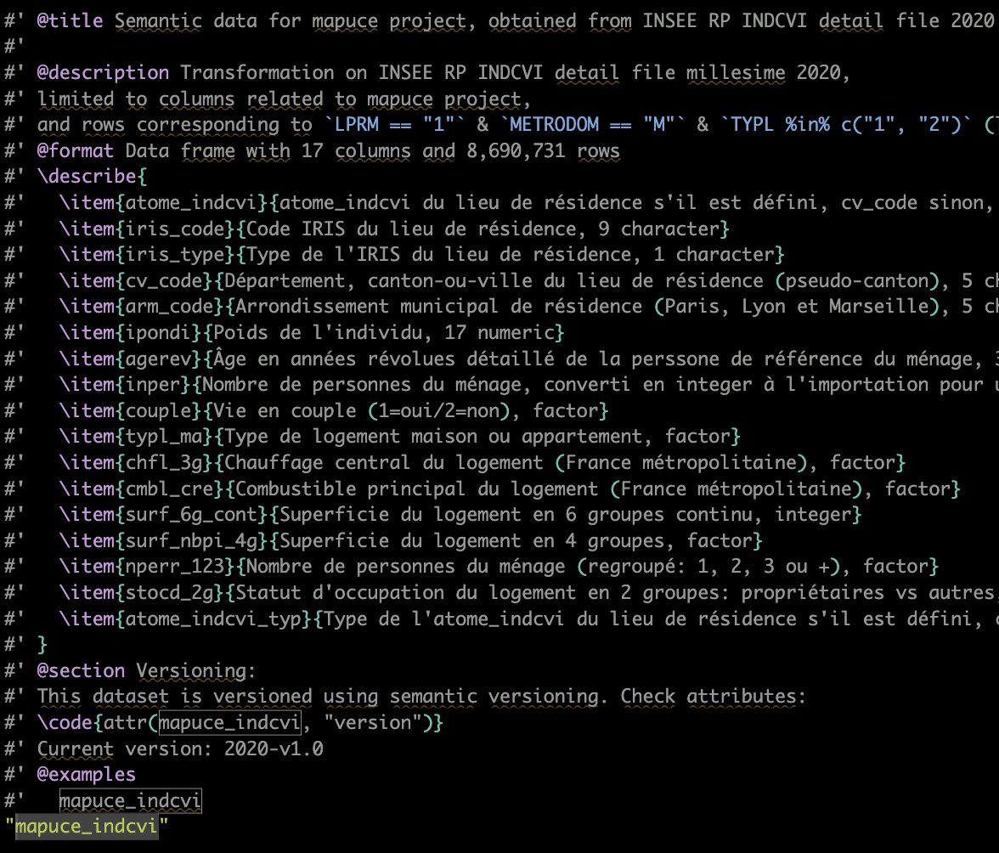
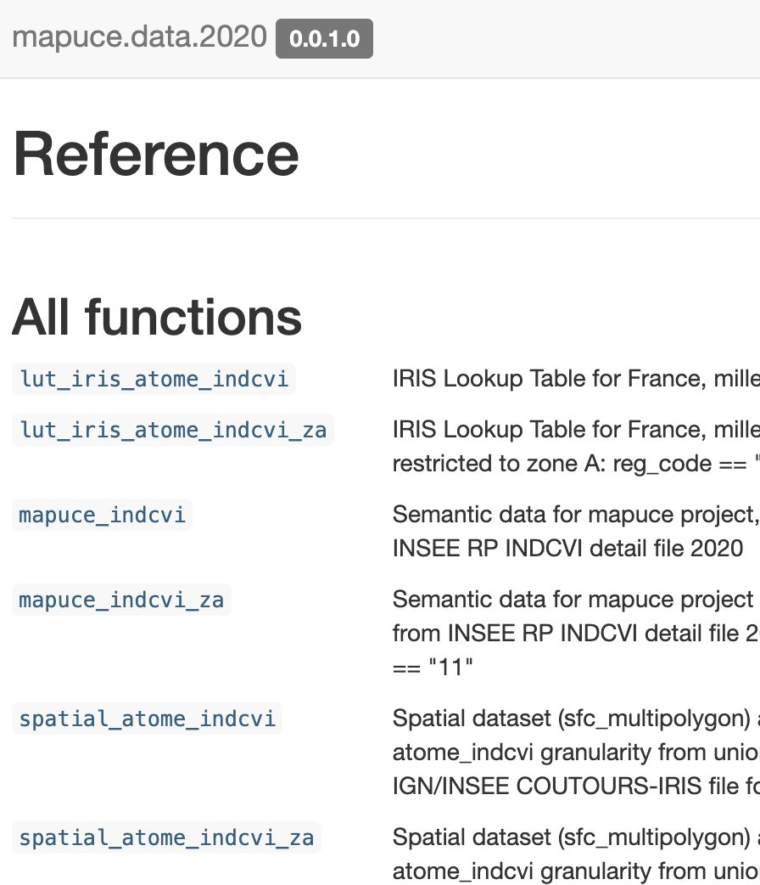
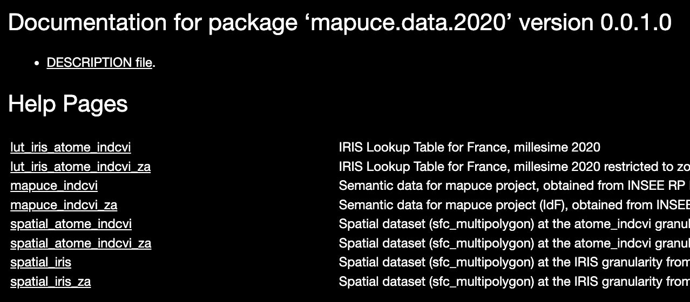
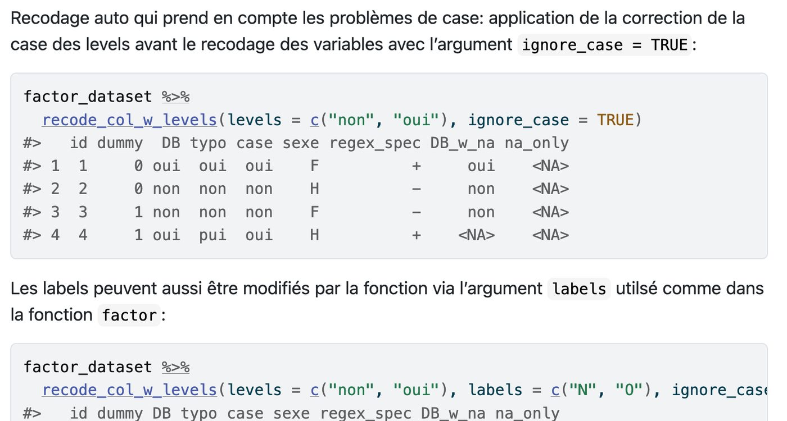
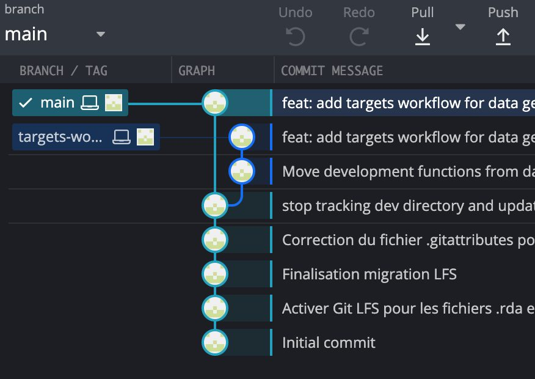
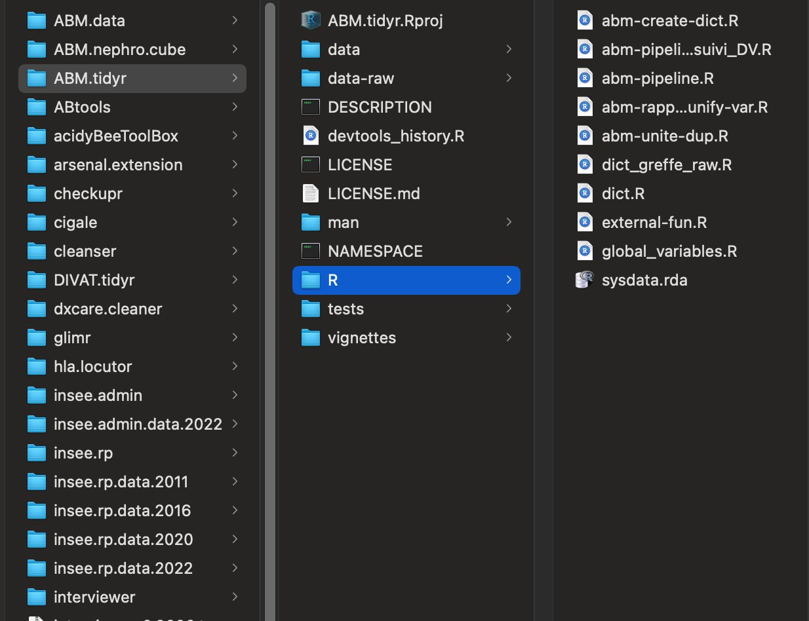
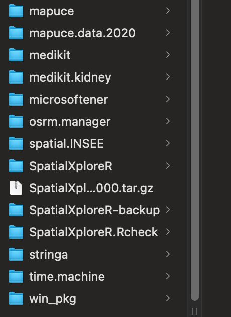

## Contexte

Un résultat qu'on ne peut pas régénérer est un résultat fragile. Je construis chaque projet pour qu'un collègue puisse le reprendre et le relancer.

## Question

Comment rendre des données Faciles à trouver, Accessibles, Interopérables et Réutilisables, au quotidien ?

## Données

Exemple : mapuce.data.2020, issu du fichier détail INSEE RP 2020 (8 690 731 lignes, 17 colonnes), avec ses couches spatiales.

## Méthode

- Packages de données : chaque variable documentée (roxygen2), site pkgdown, versionnage sémantique
- Pipeline targets : seules les étapes impactées par un changement sont recalculées
- Package cleanser : contrôles et recodages automatisés et traçables ; Git et Git LFS pour les gros fichiers

## Résultats

Environ 30 packages R développés et maintenus, dont 5 packages de données (santé, INSEE, spatial, itinéraires…), réutilisés d'un projet à l'autre.

## Figures {.figures}

::: {.gallery}
{.lightbox group="fair"}

{.lightbox group="fair"}

{.lightbox group="fair"}

{.lightbox group="fair"}

{.lightbox group="fair"}

{.lightbox group="fair"}

{.lightbox group="fair"}

{.lightbox group="fair"}
:::

::: {.case-cta}
[Un projet similaire ? Parlons-en](../contact.qmd){.btn .btn-honey}
:::
