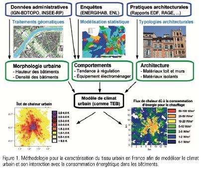
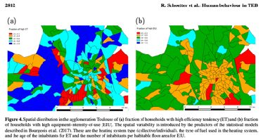
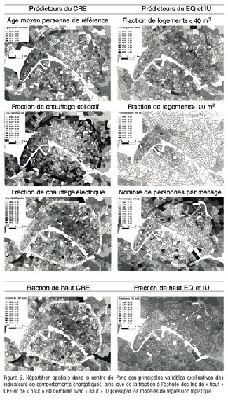

## Contexte

Les îlots de chaleur urbains dépendent aussi de nos usages : chauffage, climatisation, équipements. Le modèle de climat urbain TEB de Météo-France ne représentait pas cette diversité de comportements.

## Question

Peut-on prédire les comportements énergétiques des ménages à partir de variables disponibles partout en France, pour les injecter dans TEB ?

## Données

Trois enquêtes aux granularités et regroupements différents (Energihab, INSEE Logement, Enquête nationale Logement), harmonisées avec un important travail de feature engineering.

## Méthode

- Harmonisation des variables entre enquêtes, sélection des variables informatives
- Modèles de machine learning sélectionnés par validation croisée à 10 plis
- Application des modèles à l'IRIS et cartographie (Toulouse, Paris)

## Résultats

Des modèles de régulation thermique, de taux d'équipement et d'intensité d'usage, applicables à toute la France métropolitaine à l'échelle de l'IRIS, et intégrés à la paramétrisation de TEB (SURFEX v8.2). Ils ont ensuite été valorisés dans SpatialXploreR, une application de prospective.

## Figures {.figures}

::: {.gallery}
{.lightbox group="mapuce"}

{.lightbox group="mapuce"}

{.lightbox group="mapuce"}
:::

::: {.case-cta}
[Un projet similaire ? Parlons-en](../contact.qmd){.btn .btn-honey}
:::
