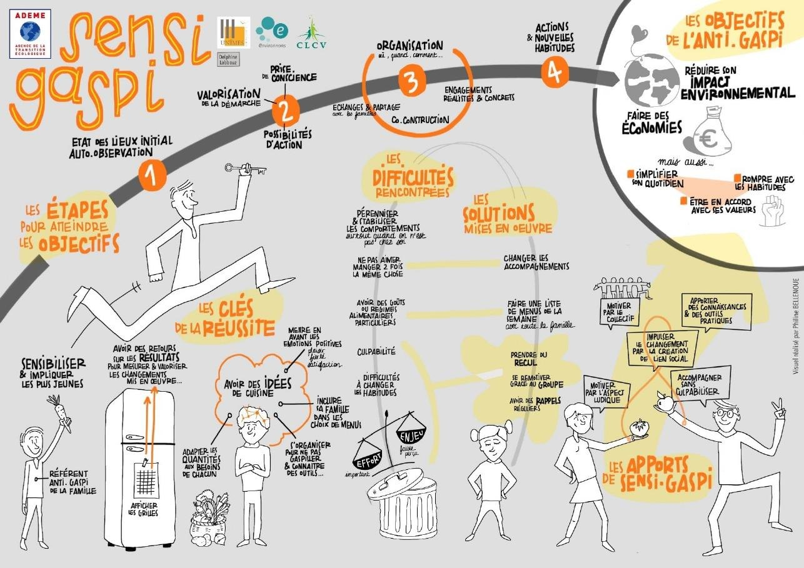
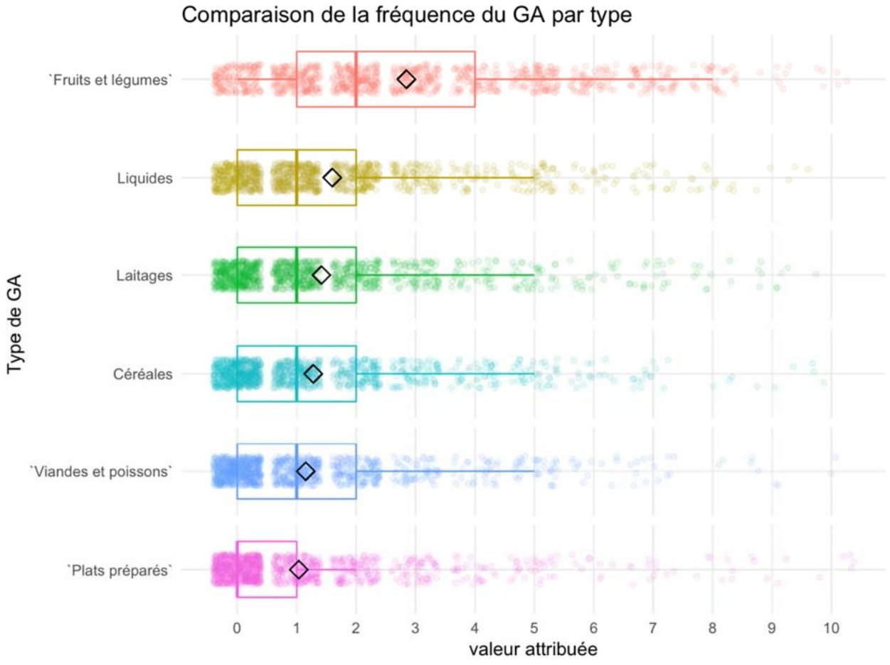
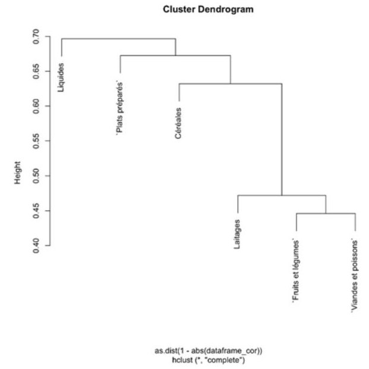
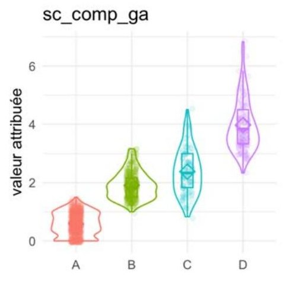
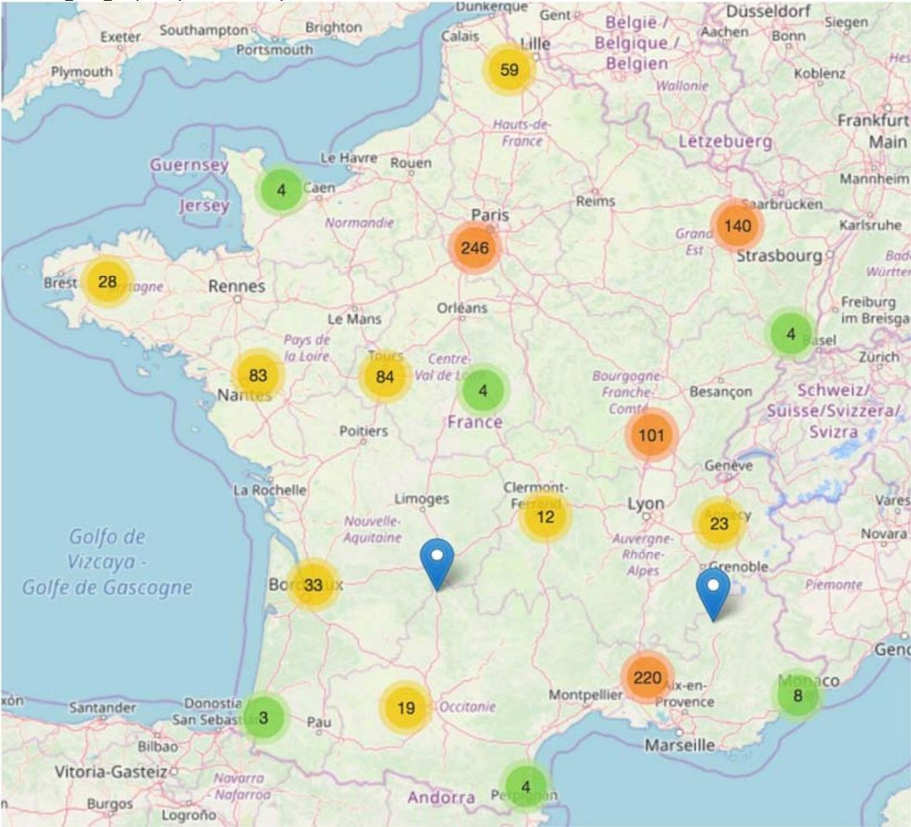

## Contexte

En France, les ménages sont le premier poste de pertes et gaspillage alimentaires (33 % du poids total, ADEME 2016). Le projet SENSI-GASPI (mai 2018 – février 2021) visait à accompagner des familles dans le changement de leurs pratiques, en s'appuyant sur la psychologie sociale et environnementale.

## Question

Quels profils de pratiques de gaspillage peut-on distinguer, et comment s'articulent-ils avec les pratiques alimentaires, les éco-gestes et les variables psychologiques (émotions, motivations, contrôle perçu) ?

## Données

Questionnaire en ligne, 1 153 répondants : 822 sans et 331 avec un message de déculpabilisation en introduction. Gaspillage déclaré pour six types d'aliments (échelle de 0 à 10), éco-gestes, pratiques alimentaires et une douzaine d'échelles psychologiques.

## Méthode

- Nettoyage et recodage, recherche des valeurs anormales et manquantes, imputations manuelles et automatiques
- Corrélations entre types d'aliments, classification hiérarchique des variables, ACP : un score global de gaspillage (1re dimension, 48 % de l'information)
- Typologie en 4 groupes pour chaque famille de pratiques, croisée avec toutes les autres variables du questionnaire
- Comparaison des deux versions du questionnaire (effet du message) et cartographie de la provenance des répondants

## Résultats

Le gaspillage déclaré est faible, sauf pour les fruits et légumes frais (moyenne de 2,9 sur 10, contre 1 à 1,6 pour les autres aliments). C'est une pratique cohérente : qui gaspille un type d'aliment gaspille aussi les autres. Moins on gaspille, plus on adopte d'éco-gestes et de bonnes pratiques alimentaires. Le message de déculpabilisation déplace les réponses sur le gaspillage (de l'ordre de 15 % sur le score), signe d'un biais de désirabilité sociale. Limite assumée : un échantillon volontaire, plus diplômé et plus sensibilisé que la moyenne. Ces résultats ont orienté l'expérimentation menée ensuite auprès de 21 familles pendant 15 mois.

## Figures {.figures}

::: {.gallery}
{.lightbox group="sensigaspi"}

{.lightbox group="sensigaspi"}

{.lightbox group="sensigaspi"}

{.lightbox group="sensigaspi"}

{.lightbox group="sensigaspi"}
:::

::: {.case-cta}
[Un projet similaire ? Parlons-en](../contact.qmd){.btn .btn-honey}
:::
