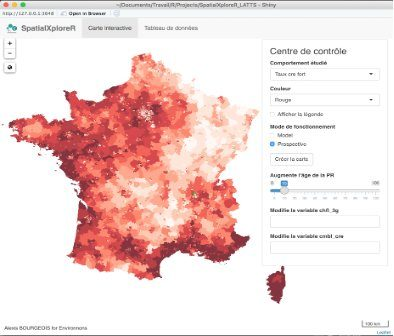
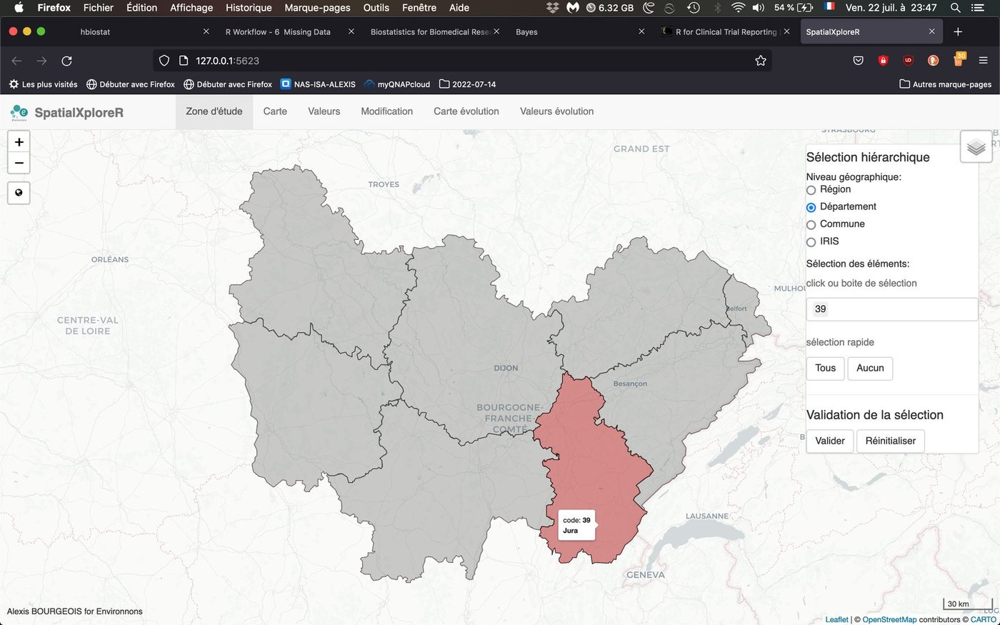
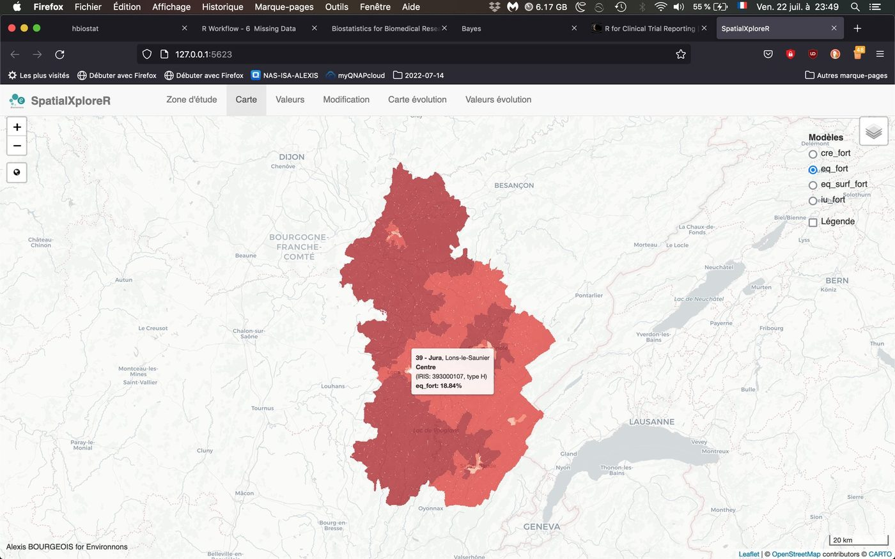
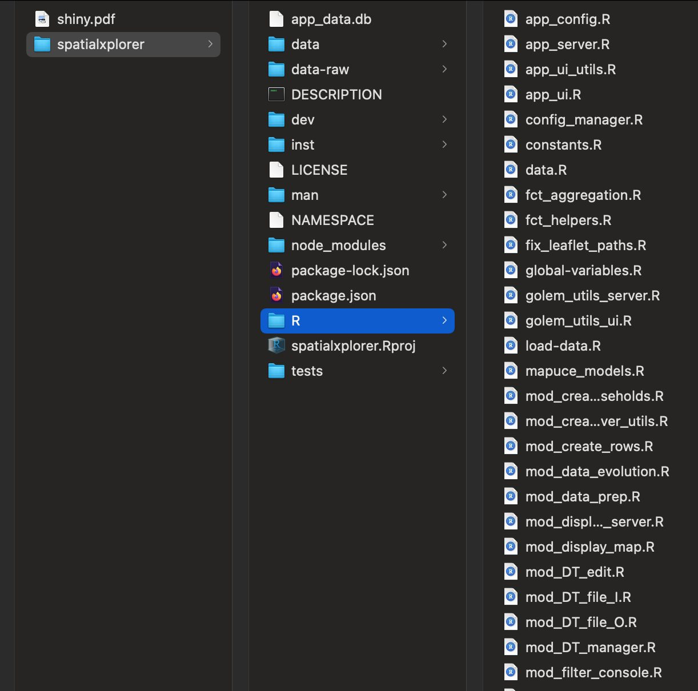

## Contexte

Une fois le projet MApUCE terminé, ses modèles de comportements énergétiques devaient servir au-delà des articles : explorer des territoires et simuler leur évolution. J'ai développé l'application au sein d'Environnons, pour le CNRS.

## Question

Comment utiliser des modèles statistiques pour simuler des scénarios d'évolution, à l'échelle fine et sans latence, par des non-spécialistes ?

## Données

Plus de 50 000 polygones IRIS pour la France métropolitaine, couplés aux sorties des modèles.

## Méthode

- Sélection hiérarchique de la zone (région, département, commune, IRIS) pour limiter le calcul et l'affichage
- Application modulaire packagée (golem) : chaque onglet est un module testable
- Mode prospectif : modifier des variables et voir l'effet sur la carte

## Résultats

Une application qui permet de choisir une zone, d'appliquer les modèles, d'agréger les résultats et de simuler des évolutions en quelques clics : par exemple le vieillissement de la population, ou un changement de mode de chauffage ou de combustible.

## Figures {.figures}

::: {.gallery}
{.lightbox group="spatialxplorer"}

{.lightbox group="spatialxplorer"}

{.lightbox group="spatialxplorer"}

{.lightbox group="spatialxplorer"}
:::

::: {.case-cta}
[Un projet similaire ? Parlons-en](../contact.qmd){.btn .btn-honey}
:::
