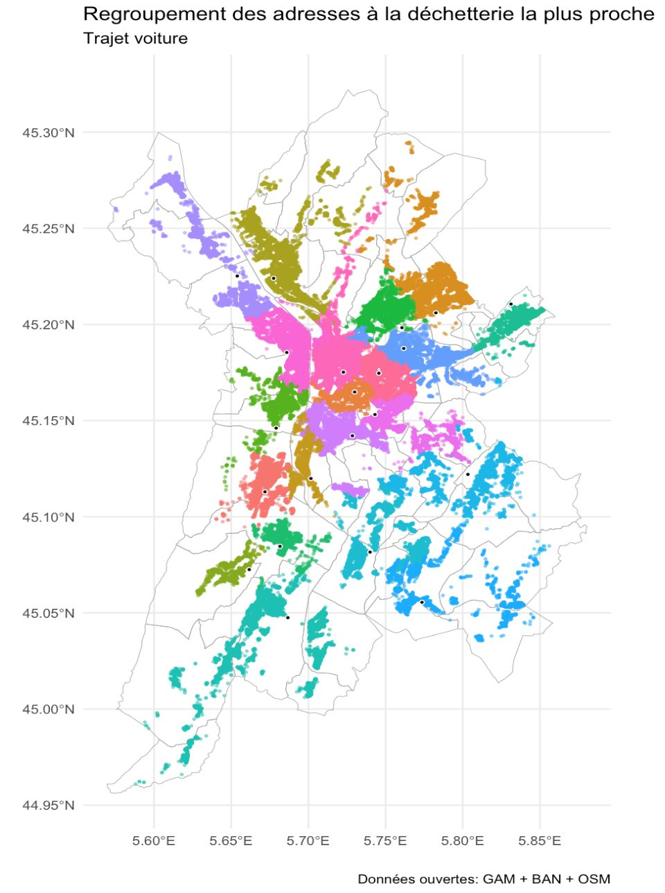
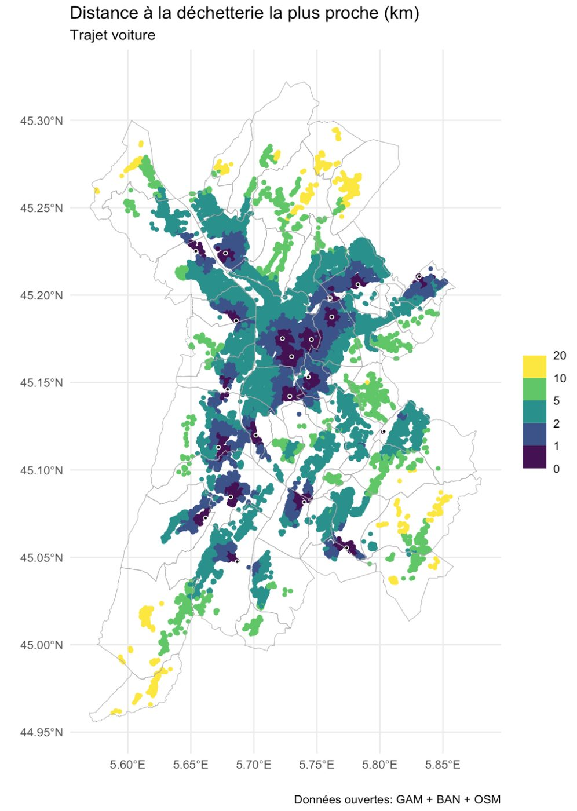
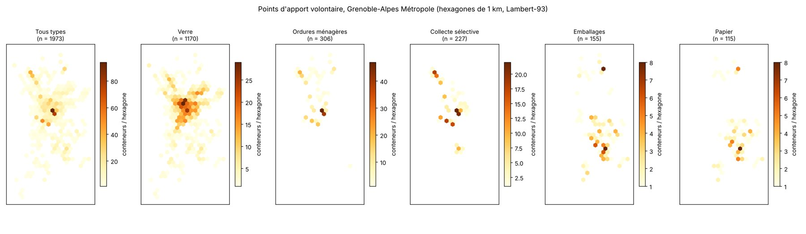
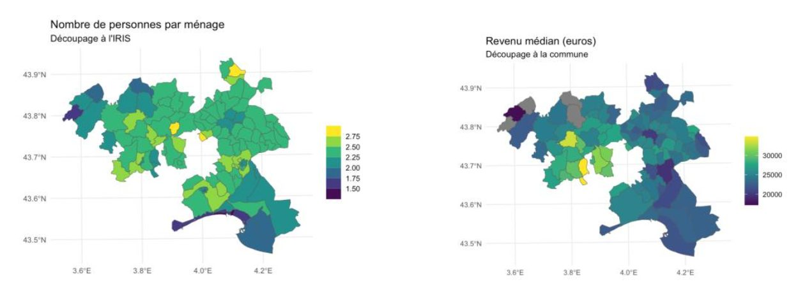
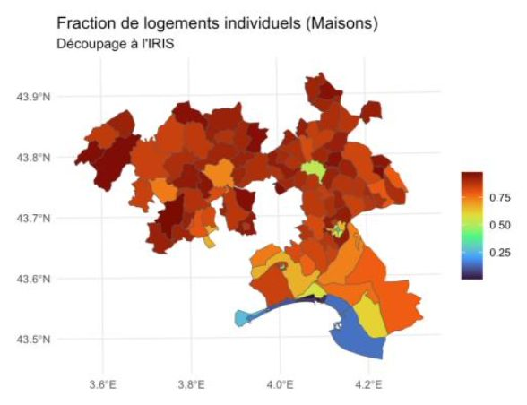

## Contexte

Pour convaincre dans une réponse à appel d'offres, rien ne vaut une démonstration sur le territoire du client, livrée en quelques jours.

## Question

Que révèlent les données ouvertes sur le territoire du Pic-Saint-Loup et de l'Étang de l'Or ? Quelle est la distance réelle des habitants à la déchetterie la plus proche (Grenoble-Alpes Métropole) ?

## Données

INSEE (recensement logement, FILOSOFI revenus, contours IRIS), BAN (adresses), OSM (réseau routier), données ouvertes de la métropole (déchetteries, 1 973 conteneurs d'apport volontaire).

## Méthode

- Agrégation à l'IRIS et à la commune, cartes choroplèthes
- Serveur OSRM local pour calculer automatiquement itinéraires et temps de trajet
- Rattachement de chaque adresse à la déchetterie la plus proche par la route
- Points d'apport volontaire : contrôle qualité (codes incohérents, dates en texte libre), projection en Lambert-93, hexbin de 1 km, en R (targets, sf) et en Python (geopandas)

## Résultats

Un fort contraste entre zones de résidences principales et zones littorales de résidences secondaires, avec des pôles intermédiaires (Mauguio, Lunel, Sommières). Une carte des distances réelles à l'adresse pour la métropole grenobloise. Le hexbin des points d'apport volontaire montre deux organisations de la collecte : le secteur Grand-Sud (Vizille, Jarrie…) sépare emballages et papier, quand le reste de la métropole s'appuie surtout sur la collecte sélective multimatériaux. Point de vigilance : selon le calage de la grille, le maximum par hexagone varie de 86 à 133 conteneurs (effet MAUP). La grille est donc calée sur des kilomètres ronds, et l'interprétation porte sur les motifs d'ensemble plutôt que sur une cellule isolée.

## Figures {.figures}

::: {.gallery}
{.lightbox group="territoires"}

{.lightbox group="territoires"}

{.lightbox group="territoires"}

{.lightbox group="territoires"}

{.lightbox group="territoires"}
:::

::: {.case-cta}
[Un projet similaire ? Parlons-en](../contact.qmd){.btn .btn-honey}
:::
